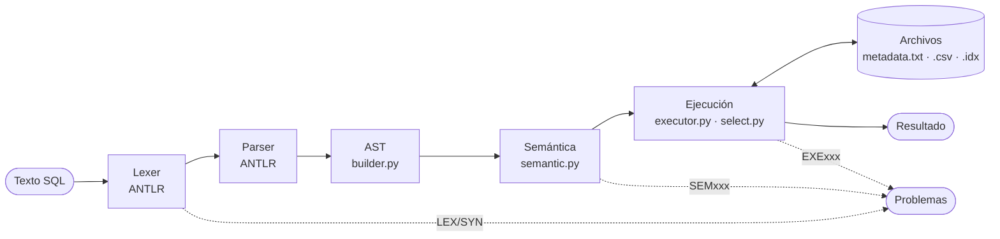

<div align="center">

# Intérprete SQL con almacenamiento en archivos

**Un motor SQL escrito desde cero: lexer y parser con ANTLR 4, AST, análisis semántico,
ejecución y almacenamiento propio en archivos de texto. Sin SQLite, MySQL ni ningún otro DBMS.**

[](https://github.com/Vann06/Proyecto_Lexer_Gen/actions/workflows/ci.yml)


[Inicio rápido](#inicio-rápido) ·
[Guía de uso](docs/guia_uso.md) ·
[SQL soportado](#sql-soportado) ·
[Arquitectura](#arquitectura) ·
[Pruebas](#pruebas) ·
[Plan del proyecto](PLAN.md)

</div>

---

## Tabla de contenido

- [Qué es](#qué-es)
- [Inicio rápido](#inicio-rápido)
- [El IDE](#el-ide)
- [Scripts de demostración](#scripts-de-demostración)
- [SQL soportado](#sql-soportado)
- [Arquitectura](#arquitectura)
- [Almacenamiento](#almacenamiento)
- [Errores](#errores)
- [Pruebas](#pruebas)
- [Estructura del repositorio](#estructura-del-repositorio)
- [Documentación](#documentación)
- [Equipo](#equipo)

## Qué es

Proyecto del curso **Construcción de Compiladores** (2026): un sistema que
interpreta y ejecuta SQL con su propio mecanismo de almacenamiento.

- 🧩 **Pipeline completo de compilador**: léxico → sintáctico → AST → semántico → interpretación.
- 📁 **Almacenamiento propio**: cada base es un directorio; esquema en `metadata.txt`, una tabla por `.csv`, un índice por `.idx`.
- 🔎 **Índices reales**: el `WHERE` y el `JOIN` buscan en el índice (búsqueda binaria) en vez de recorrer la tabla, y el resultado muestra el plan usado.
- 🪆 **Subconsultas**: `IN` / `NOT IN`, `EXISTS` / `NOT EXISTS` y escalares, incluidas las correlacionadas.
- 🛡️ **Análisis semántico** antes de ejecutar, con 19 códigos de error en español y su línea y columna.
- 🖥️ **IDE web**: tokens, árbol sintáctico, AST, problemas, resultados y catálogo.

> [!NOTE]
> Esta rama (`SQL`) es el intérprete SQL. La versión anterior del proyecto
> (un generador propio de lexers y parsers en Rust, con Compiscript) vive en la
> rama [`main`](https://github.com/Vann06/Proyecto_Lexer_Gen/tree/main).

## Inicio rápido

### Con Docker

```bash
docker compose up --build
```

- IDE: <http://localhost:4000>
- API: <http://localhost:8080> (documentación interactiva en <http://localhost:8080/docs>)

Las bases de datos quedan en `./data/` y sobreviven a reiniciar los contenedores.

### Sin Docker

Requiere Python 3.11 o superior.

```bash
cd backend
pip install -r requirements-dev.txt
python -m uvicorn api.main:app --port 8080
```

En otra terminal, desde la raíz del repositorio:

```bash
python -m http.server 4000 --directory frontend/IDE-lite
```

Abrir <http://localhost:4000>, elegir un script del panel **WORKSPACE** y pulsar **▶ EJECUTAR**.
La [guía de uso](docs/guia_uso.md) explica cada pantalla paso a paso.

## El IDE

| Botón / pestaña | Qué muestra |
|---|---|
| **▶ ANALIZAR** | Análisis léxico, sintáctico y semántico del script, **sin ejecutarlo** |
| **▶ EJECUTAR** | Ejecuta sentencia por sentencia sobre la base activa y se detiene en el primer error |
| TOKENS | El flujo de tokens con tipo, lexema, línea y columna |
| ÁRBOL SINTÁCTICO | El árbol de derivación de ANTLR (regla · alternativa) |
| AST | El árbol de sintaxis abstracta que usan la semántica y el motor |
| PROBLEMAS | Errores léxicos, sintácticos, semánticos y de ejecución; clic → salta a la línea |
| RESULTADOS | Una tarjeta por sentencia: tabla de resultados, filas afectadas y plan (`índice idx_edad` o `recorrido completo`) |
| CATÁLOGO | Tablas, columnas, tipos, restricciones, cantidad de filas e índices de la base activa |

## Scripts de demostración

Un script por entrega en [`workspace/`](workspace/). Los de ejemplo crean su
propia base al empezar, así que se pueden ejecutar en cualquier orden y
repetir. [`tests/test_workspace.py`](backend/tests/test_workspace.py) verifica
que cada uno haga lo que promete.

| Entrega | Script | Cómo verlo |
|---|---|---|
| 1 · Lexer y parser | [`entrega1_lexer_parser.sql`](workspace/entrega1_lexer_parser.sql) · [`entrega1_errores.sql`](workspace/entrega1_errores.sql) | ▶ ANALIZAR → TOKENS, ÁRBOL SINTÁCTICO, PROBLEMAS |
| 2 · AST | [`entrega2_ast.sql`](workspace/entrega2_ast.sql) | ▶ ANALIZAR → AST |
| 3 · Análisis semántico | [`entrega3_errores_semanticos.sql`](workspace/entrega3_errores_semanticos.sql) | ▶ ANALIZAR → PROBLEMAS (un error por línea) |
| 4 · CREATE, DROP, INSERT | [`entrega4_create_drop_insert.sql`](workspace/entrega4_create_drop_insert.sql) | ▶ EJECUTAR → RESULTADOS, CATÁLOGO |
| 5 · SELECT, WHERE, UPDATE, DELETE | [`entrega5_select_update_delete.sql`](workspace/entrega5_select_update_delete.sql) | ▶ EJECUTAR → RESULTADOS |
| 6 · JOIN, agregaciones, GROUP BY | [`entrega6_join_agregados.sql`](workspace/entrega6_join_agregados.sql) | ▶ EJECUTAR → RESULTADOS |
| 7 · Índices y subconsultas | [`entrega7_indices_subconsultas.sql`](workspace/entrega7_indices_subconsultas.sql) | ▶ EJECUTAR → RESULTADOS (mirar el plan) |
| 8 · Integración | [`entrega8_integracion.sql`](workspace/entrega8_integracion.sql) | ▶ ANALIZAR y ▶ EJECUTAR |

[`demo.sql`](workspace/demo.sql) es un recorrido corto por todo el SQL; es el que abre el IDE al iniciar.

## SQL soportado

| Categoría | Sentencias y cláusulas |
|---|---|
| Definición | `CREATE TABLE` (con `IF NOT EXISTS`), `DROP TABLE` (con `IF EXISTS`), `CREATE [UNIQUE] INDEX`, `DROP INDEX` |
| Restricciones | `PRIMARY KEY` (simple y compuesta), `NOT NULL`, `UNIQUE`; `FOREIGN KEY` y `CHECK` se validan y se guardan |
| Manipulación | `INSERT` (varias filas, lista de columnas), `UPDATE` (asignación simultánea), `DELETE` |
| Consultas | `SELECT`, `FROM`, `WHERE`, `AND` / `OR` / `NOT`, `ORDER BY` (varias claves, `ASC`/`DESC`), `DISTINCT`, `LIMIT` / `OFFSET` |
| Predicados | `=`, `<>`, `<`, `<=`, `>`, `>=`, `IS [NOT] NULL`, `[NOT] IN (lista)`, `[NOT] LIKE`, `[NOT] BETWEEN` |
| Combinación | `INNER JOIN` (varias tablas, alias; usa índices cuando puede) |
| Agregación | `COUNT(*)`, `COUNT([DISTINCT] x)`, `SUM`, `AVG`, `MIN`, `MAX`, `GROUP BY`, `HAVING` |
| Subconsultas | `IN` / `NOT IN`, `EXISTS` / `NOT EXISTS`, escalares en comparaciones; correlacionadas y anidadas |
| Bases de datos | `CREATE DATABASE`, `DROP DATABASE`, `USE`, `SHOW DATABASES`, `SHOW TABLES`, `DESCRIBE` |
| Tipos | `INT`, `FLOAT`, `VARCHAR(n)`, `BOOLEAN`, `DATE` (`YYYY-MM-DD`); también `CHAR(n)` |

`NULL` sigue la lógica de tres valores de SQL en todas las expresiones (`NULL = 1`
no es verdadero ni falso). No soportado: `ALTER TABLE`, `LEFT` / `RIGHT` /
`CROSS JOIN` (dan `SEM099`) y `DEFAULT` (se ignora con una advertencia).

## Arquitectura



| Etapa | Módulo | Qué hace |
|---|---|---|
| Léxico y sintáctico | [`grammar/SQL.g4`](backend/grammar/SQL.g4) → [`dbms/parser/`](backend/dbms/parser/) | ANTLR genera el lexer y el parser; [`frontend/parse.py`](backend/dbms/frontend/parse.py) traduce los errores al español |
| AST | [`ast.py`](backend/dbms/ast.py), [`builder.py`](backend/dbms/builder.py) | Dataclasses limpias, con posición en cada nodo |
| Semántica | [`semantic.py`](backend/dbms/semantic.py) | Tablas, columnas, tipos, ambigüedad, agregados y subconsultas contra el catálogo |
| Ejecución | [`executor.py`](backend/dbms/executor.py), [`eval.py`](backend/dbms/eval.py), [`select.py`](backend/dbms/select.py), [`join.py`](backend/dbms/join.py), [`aggregate.py`](backend/dbms/aggregate.py), [`subquery.py`](backend/dbms/subquery.py) | Evaluación con NULL, tubería FROM → JOIN → WHERE → GROUP → HAVING → ORDER |
| Almacenamiento | [`storage.py`](backend/dbms/storage.py), [`catalog.py`](backend/dbms/catalog.py), [`sqltypes.py`](backend/dbms/sqltypes.py), [`index.py`](backend/dbms/index.py) | Archivos de texto con escritura atómica; índices ordenados con búsqueda binaria |
| Interfaz | [`api/main.py`](backend/api/main.py), [`frontend/IDE-lite/`](frontend/IDE-lite/) | API HTTP (FastAPI) e IDE web (React) |

## Almacenamiento

```text
data/
└── universidad/              ← una base de datos = un directorio
    ├── metadata.txt          ← esquema: columnas, tipos, restricciones, índices
    ├── estudiantes.csv       ← los registros de una tabla
    ├── estudiantes.csv.pos   ← posición de cada fila en el .csv (acceso directo)
    └── idx_edad.idx          ← un índice: valor|rowid,rowid,… ordenado por valor
```

<details>
<summary>Ejemplo de <code>metadata.txt</code> y de un <code>.csv</code></summary>

```text
TABLE estudiantes
  COLUMN id INT NOT NULL
  COLUMN nombre VARCHAR(40) NOT NULL
  COLUMN edad INT
  COLUMN ingreso DATE
  PRIMARY KEY pk_estudiantes (id)
  NEXT_ROWID 4

INDEX pk_estudiantes ON estudiantes (id) UNIQUE IMPLICIT
INDEX idx_edad ON estudiantes (edad)
```

```text
_rowid,id,nombre,edad,ingreso
1,1,Ana,20,2023-01-15
2,2,"O'Brien, José",\N,2024-02-29
```

`\N` es NULL. El `_rowid` nunca se reutiliza: es la dirección a la que apuntan los índices.
</details>

El formato completo está en [`PLAN.md`](PLAN.md#b-almacenamiento-catálogo-y-tipos--) y el de los índices en [`docs/motor.md`](docs/motor.md#formato-y-funcionamiento-de-índices).

## Errores

Todos los errores traen código, mensaje en español, línea y columna.

| Prefijo | Etapa | Ejemplos |
|---|---|---|
| `LEX` | Léxico | `LEX001` carácter no reconocido · `LEX002` cadena sin cerrar |
| `SYN` | Sintáctico | `SYN001` entrada inesperada · `SYN002` entrada sobrante · `SYN003` falta un token · `SYN004` sentencia no válida |
| `SEM` | Semántico | `SEM001` tabla inexistente · `SEM003` columna inexistente · `SEM004` referencia ambigua · `SEM006` tipos incompatibles · `SEM008` valor inválido en INSERT · `SEM010`/`SEM011` índice inexistente / duplicado · `SEM012` subconsulta con más de una columna — [lista completa](PLAN.md#c-análisis-semántico--) |
| `EXE` | Ejecución | `EXE001` llave duplicada · `EXE002` NULL en NOT NULL · `EXE003` escalar con más de un registro — [lista completa](docs/motor.md#errores-y-límites) |

## Pruebas

```bash
cd backend
python -m pytest -q                        # toda la suite
python -m pytest tests/test_rubrica.py -v  # la rúbrica del enunciado, un test por requisito
```

La **rúbrica** ([`tests/test_rubrica.py`](backend/tests/test_rubrica.py)) tiene un
test por cada requisito del enunciado (`test_R01_analisis_lexico…` a
`test_R30_caso_extremo…`), sobre datos extremos: comillas y comas dentro de
cadenas, Unicode, NULL en cada tipo, fechas bisiestas, tablas vacías. Si algo se
rompe, el nombre del test que falla dice qué requisito dejó de cumplirse.

| Archivo | Qué cubre |
|---|---|
| [`test_rubrica.py`](backend/tests/test_rubrica.py) | Cada requisito del enunciado, de punta a punta por la API |
| [`test_aceptacion.py`](backend/tests/test_aceptacion.py) | Los criterios "hecho cuando" de cada fase de [`PLAN.md`](PLAN.md) |
| [`test_workspace.py`](backend/tests/test_workspace.py) | Que cada script de demostración haga lo que promete |
| `test_grammar` · `test_builder` · `test_ast_dot` | Lexer, parser y AST |
| `test_semantic` | Un caso correcto y uno incorrecto por cada código `SEMxxx` |
| `test_sqltypes` · `test_catalog` · `test_storage` | Tipos, catálogo y archivos |
| `test_eval` · `test_executor` · `test_select` · `test_join` · `test_aggregate` | El motor |
| `test_index` · `test_join_index` · `test_subquery` | Índices (incluida comparación aleatoria contra recorrido completo) y subconsultas |
| `test_api` | Los endpoints HTTP |

El [CI](.github/workflows/ci.yml) corre la rúbrica, la suite completa y verifica
que el parser generado coincida con la gramática en cada push a `SQL`.

## Estructura del repositorio

```text
.
├── backend/
│   ├── grammar/SQL.g4      # gramática ANTLR: fuente de verdad del lexer y el parser
│   ├── dbms/               # el intérprete (ver Arquitectura)
│   │   └── parser/         # GENERADO por ANTLR (versionado; no editar a mano)
│   ├── api/main.py         # API HTTP (FastAPI)
│   └── tests/              # pytest
├── frontend/IDE-lite/      # IDE web (React sin build; nginx en Docker)
├── workspace/              # scripts .sql que ve el IDE: demo y uno por entrega
├── docs/                   # guía de uso y documentación del motor
├── scripts/gen_parser.*    # regenera backend/dbms/parser/ desde SQL.g4
├── data/                   # bases de datos (no versionado; se cambia con DBMS_DATA)
├── PLAN.md                 # fases, decisiones de diseño y reparto del trabajo
└── docker-compose.yml
```

## Documentación

| Documento | Para qué |
|---|---|
| [Guía de uso](docs/guia_uso.md) | Instalar, levantar, usar el IDE y la API, problemas frecuentes |
| [Motor SQL](docs/motor.md) | Contratos internos, formato de índices, errores de ejecución y límites |
| [Plan del proyecto](PLAN.md) | Fases A–E, formatos de archivo, códigos semánticos, reparto del trabajo |
| [IDE](frontend/IDE-lite/README.md) | Cómo está hecho el IDE y qué endpoint alimenta cada pestaña |

<details>
<summary>Regenerar el parser después de cambiar <code>SQL.g4</code></summary>

```bash
sh scripts/gen_parser.sh        # o en Windows: powershell scripts/gen_parser.ps1
```

La primera vez, `antlr4-tools` ofrece descargar Java y el jar de ANTLR; hay que
aceptar. El parser generado se versiona: ni Docker ni el CI necesitan Java para
correr, y el CI falla si alguien cambia la gramática sin regenerarlo.
</details>

## Equipo

| Integrante | Parte principal |
|---|---|
| Ricardo Godínez ([@Ricgo01](https://github.com/Ricgo01)) | Gramática, AST, análisis semántico, subconsultas, JOIN y agregados |
| Vianka Castro ([@Vann06](https://github.com/Vann06)) | Motor: ejecución, evaluador de expresiones e índices |
| Javier André Benitez García | Integración: API de ejecución e IDE |

Construcción de Compiladores · Universidad del Valle de Guatemala · 2026
